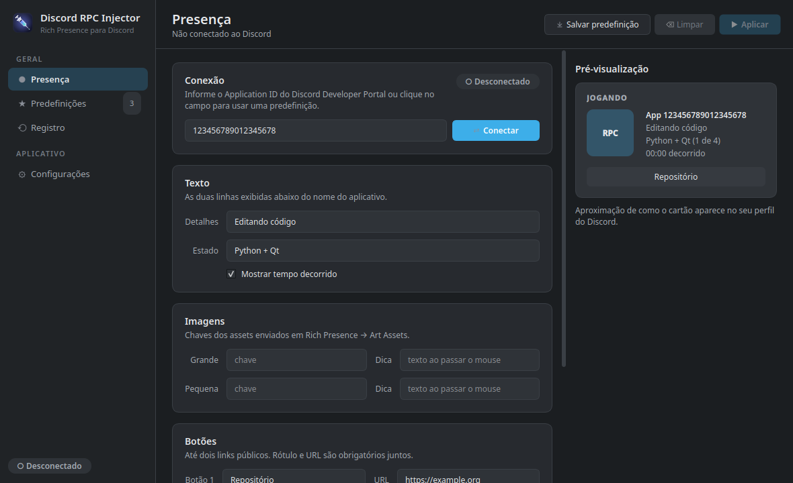
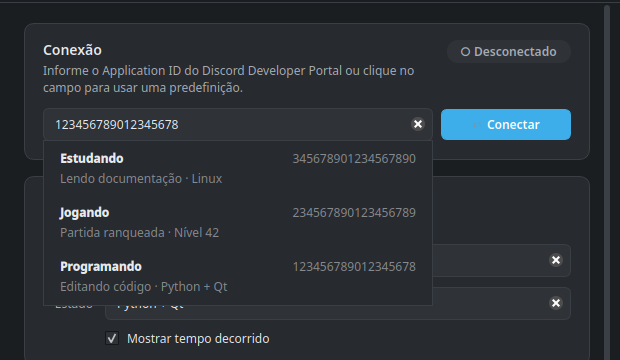

<p align="center">
  
</p>

<h1 align="center">Discord RPC Injector</h1>

<p align="center">
  Defina o <b>Rich Presence</b> ("Jogando…") do seu Discord no Linux, com uma interface
  moderna, incluindo o <b>Discord Flatpak</b>, sem configuração manual e sem <code>sudo</code>.
</p>

<p align="center">
  
</p>

## Recursos

- **Funciona com qualquer Discord local:** nativo (rpm/deb/tar.gz), **Flatpak**, Snap,
  Canary e Vesktop. O socket é encontrado automaticamente, sem links simbólicos à mão.
- **Editor completo:** detalhes, estado, tempo decorrido, imagens, até 2 botões e grupo
  (party), com **pré-visualização ao vivo** e validação dos campos.
- **Predefinições:** salve, busque, renomeie e exclua (com desfazer). Para carregar uma,
  basta clicar no campo *Application ID*.
- **Visual de app desktop moderno:** barra lateral, barra superior com ações por página,
  busca, estados vazios, notificações e diálogos.
- **Tema claro, escuro ou do sistema:** no KDE Plasma segue o esquema de cores e a cor de
  destaque, e atualiza sozinho quando você troca o tema.
- **Bandeja do sistema**, atalhos de teclado e atalho no menu de aplicativos.
- **Motor independente:** `discord_rpc_injector.py` usa só a biblioteca padrão e pode ser
  importado em seus próprios scripts.

<p align="center">
  
</p>

## Início rápido

**1. Instale o PySide6** (6.5 ou mais novo):

```bash
# Fedora
sudo dnf install python3-pyside6

# Ubuntu / Debian
sudo apt install python3-pyside6.qtwidgets python3-pyside6.qtsvg

# Qualquer distro, sem mexer no sistema
python3 -m venv .venv && .venv/bin/pip install -r requirements.txt
```

**2. Abra o app:**

```bash
python3 main.py
```

**3. (Opcional) Crie o atalho no menu de aplicativos:**

```bash
python3 main.py --install-desktop
```

## Como usar

1. Crie um aplicativo em <https://discord.com/developers/applications>. O nome dele é o
   que aparece em "Jogando …". Copie o **Application ID**.
2. Com o Discord aberto, cole o ID no app e clique em **Conectar**.
3. Preencha os campos e clique em **Aplicar** (Ctrl+Enter).

O passo a passo completo, com imagens e botões, está em
[Primeiros passos](docs/02-primeiros-passos.md).

## Compatibilidade

| Discord                    | Fedora e derivadas | Ubuntu / Debian |
|----------------------------|:------------------:|:---------------:|
| Nativo (rpm, deb, tar.gz)  | ✅                 | ✅              |
| Flatpak (Flathub)          | ✅                 | ✅              |
| Snap                       | ✅                 | ✅              |

Não precisa de `sudo` nem de acesso à internet: o app conversa só com o Discord já aberto
no seu computador e grava tudo em pastas do seu usuário. Detalhes em
[Compatibilidade](docs/05-compatibilidade.md).

## Documentação

| Para quem usa                                        | Para quem desenvolve                                   |
|------------------------------------------------------|--------------------------------------------------------|
| [Instalação](docs/01-instalacao.md)                  | [Arquitetura](docs/07-arquitetura.md)                  |
| [Primeiros passos](docs/02-primeiros-passos.md)      | [Desenvolvimento e testes](docs/08-desenvolvimento.md) |
| [Usando o app](docs/03-usando-o-app.md)              | [Referência do motor](docs/09-referencia-do-motor.md)  |
| [Como funciona](docs/04-como-funciona.md)            |                                                        |
| [Compatibilidade](docs/05-compatibilidade.md)        |                                                        |
| [Solução de problemas](docs/06-solucao-de-problemas.md) |                                                     |

Índice completo: [docs/README.md](docs/README.md).

## Estrutura do projeto

```
discord_rpc_injector.py   motor: IPC com o Discord + predefinições (só biblioteca padrão)
main.py                   abre o app; --install-desktop / --uninstall-desktop
rpc_ui/                   interface Qt: core/, theme/, widgets/, pages/
tests/                    testes automatizados (sem abrir janelas e sem Discord real)
docs/                     documentação
```

## Testes

```bash
python3 -m unittest discover -s tests -t .
```

Os testes cobrem a inicialização, a navegação, a interação com a interface e o motor,
incluindo um servidor que simula o socket de cada tipo de instalação do Discord.

## Usando só o motor

```python
from discord_rpc_injector import DiscordIPC

ipc = DiscordIPC("123456789012345678")
ipc.connect()
ipc.set_activity({"details": "Programando", "state": "Python"})
```

Veja a [Referência do motor](docs/09-referencia-do-motor.md).

## Seus dados

| Arquivo                                                | Conteúdo                         |
|--------------------------------------------------------|----------------------------------|
| `~/.config/discord-rpc-injector/presets.json`          | Predefinições                    |
| `~/.config/DiscordRPCInjector/DiscordRPCInjector.conf` | Preferências (tema, bandeja…)    |

O app não usa seu token nem sua senha do Discord.
