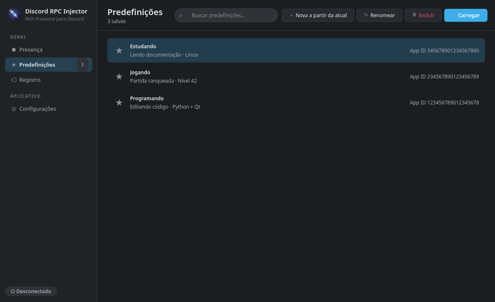
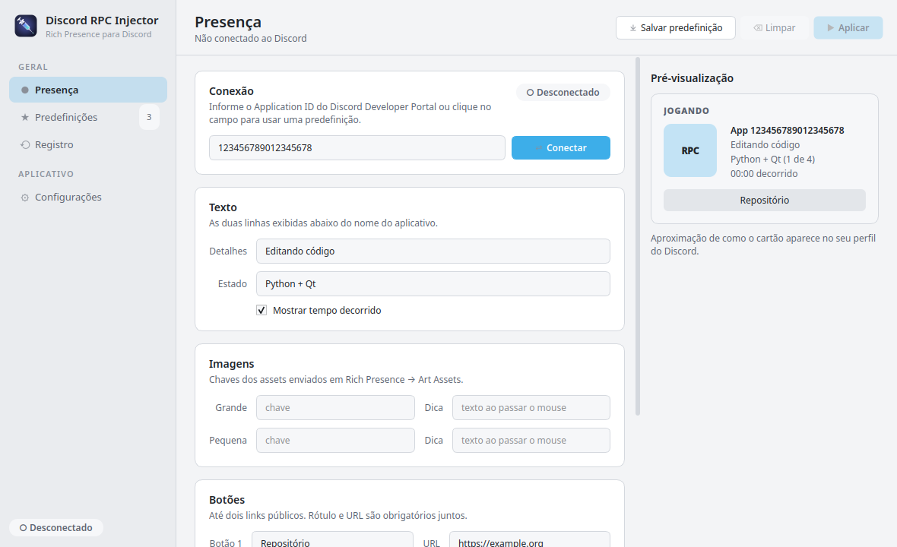

# 3. Usando o app

> **Resumo:** quatro páginas na barra lateral; a barra superior mostra o título da página,
> a busca (quando existe) e os botões de ação da página atual.

```
┌──────────────┬──────────────────────────────────────────────────────┐
│ ▣ Discord RPC│ Título da página           [busca]   [ações da página]│
│              ├──────────────────────────────────────────────────────┤
│ ● Presença   │                                                      │
│ ★ Predefin.  │                 conteúdo da página                   │
│ ⟲ Registro   │                                                      │
│ ⚙ Config.    │                                       ┌────────────┐ │
│              │                                       │ notificação│ │
│ ○ Desconect. │                                       └────────────┘ │
└──────────────┴──────────────────────────────────────────────────────┘
```

O selo no rodapé da barra lateral mostra o estado da conexão em qualquer página.

## Presença

O editor principal, descrito em detalhes em [Primeiros passos](02-primeiros-passos.md).

- **Ações:** Salvar predefinição · Limpar · Aplicar.
- **Subtítulo:** indica o estado, como "Não conectado", "Pronto para aplicar",
  "Presença ativa no Discord" ou **"Alterações não aplicadas"** (quando você edita os campos
  depois de aplicar).
- **Validação:** antes de enviar, o app confere os botões (rótulo e URL juntos; URL com
  `http://` ou `https://`) e o grupo (números, com máximo ≥ tamanho). Os campos com problema
  ficam com a borda vermelha.

### Escolher uma predefinição pelo campo Application ID

Clique no campo **Application ID** (ou aperte **↓** nele) para ver a lista de predefinições
salvas, com nome, App ID e textos.

- Digite parte do App ID para filtrar.
- Clique num item, ou use **↑/↓** + **Enter**, para carregar todos os campos dele.
- **Enter** sem item selecionado continua sendo "Conectar".
- Com a conexão aberta o campo fica bloqueado. Para trocar de App ID, desconecte primeiro.

## Predefinições

Lista de tudo o que você salvou. O número ao lado do item na barra lateral é o total.



| Ação                    | O que faz                                                   |
|-------------------------|-------------------------------------------------------------|
| Nova a partir da atual  | Salva os campos da página Presença com um nome              |
| Renomear                | Troca o nome (não deixa repetir um nome existente)          |
| Excluir                 | Pede confirmação; a notificação oferece **Desfazer** por 7 s |
| Carregar                | Preenche a página Presença (duplo clique também funciona)   |

A **busca** procura no nome, nos textos e no App ID. Use várias palavras para refinar.

## Registro

Histórico da sessão: conexões, envios, erros e predefinições usadas.

- **Busca** filtra pelo texto da mensagem.
- O seletor de nível mostra só sucesso, avisos, erros ou informações.
- **Limpar registro** apaga o histórico (ele não é salvo em disco).

## Configurações

- **Aparência:**
  - **Sistema** segue as cores e a cor de destaque do KDE Plasma (lidas de
    `~/.config/kdeglobals`) e se atualiza sozinho quando você troca o tema do Plasma.
    Em outros ambientes, usa a paleta do Qt.
  - **Claro** e **Escuro** fixam o tema.

  
- **Comportamento:** "Manter na bandeja do sistema ao fechar a janela". Se não houver
  bandeja disponível (comum no GNOME sem extensão), a opção fica desativada e fechar a
  janela encerra o app.
- **Sobre:** versão e local do arquivo de predefinições.

## Notificações

Aparecem no canto inferior direito e somem sozinhas. Passar o mouse por cima pausa o tempo.
Erros ficam visíveis por mais tempo.

## Atalhos de teclado

| Atalho        | Ação                                         |
|---------------|----------------------------------------------|
| Ctrl+1        | Página Presença                              |
| Ctrl+2        | Página Predefinições                         |
| Ctrl+3        | Página Registro                              |
| Ctrl+,        | Página Configurações                         |
| Ctrl+F        | Busca (vai para Predefinições se a página atual não tiver busca) |
| Ctrl+S        | Salvar os campos atuais como predefinição    |
| Ctrl+Enter    | Aplicar a presença                           |
| Ctrl+Q        | Sair do app (mesmo com a bandeja ativa)      |
| ↓ (no App ID) | Abrir a lista de predefinições               |

## Bandeja do sistema

Com a bandeja ativa, fechar a janela **não encerra** o app: ele continua rodando e a
presença continua no Discord. Clique no ícone da bandeja para reabrir, ou use o menu dele
(**Abrir** / **Sair**). Ao sair, a presença é removida.

---

Anterior: [Primeiros passos](02-primeiros-passos.md) · Próximo: [Como funciona](04-como-funciona.md)
