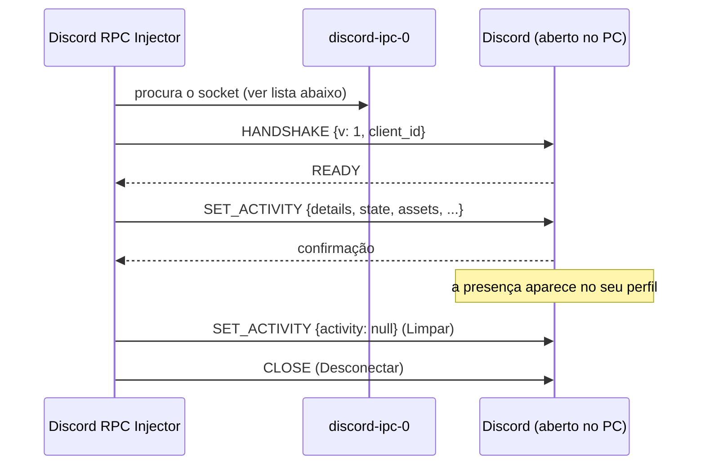

# 4. Como funciona

> **Resumo:** o Discord aberto no seu PC escuta num arquivo especial chamado
> `discord-ipc-0`. O app encontra esse arquivo, se apresenta com o Application ID e envia a
> atividade em JSON. Não há servidor externo, token nem login envolvido.

## A ideia em uma imagem



## 1. Encontrar o socket

Cada forma de instalar o Discord coloca o socket num lugar diferente. O motor procura nesta
ordem e usa o primeiro que responder:

| Ordem | Pasta                                                   | Quem cria                         |
|-------|---------------------------------------------------------|-----------------------------------|
| 1     | `$XDG_RUNTIME_DIR/`                                     | Discord nativo (rpm, deb, tar.gz) |
| 2     | `$XDG_RUNTIME_DIR/app/com.discordapp.Discord/`          | Discord Flatpak (Flathub)         |
| 3     | `$XDG_RUNTIME_DIR/.flatpak/com.discordapp.Discord/xdg-run/` | Discord Flatpak (Flatpak 1.15+) |
| 4     | mesmas duas pastas para `com.discordapp.DiscordCanary` e `dev.vencord.Vesktop` | Canary e Vesktop Flatpak |
| 5     | `$XDG_RUNTIME_DIR/snap.discord/`                        | Discord Snap                      |
| 6     | `$TMPDIR`, `$TMP`, `$TEMP`, `/tmp`                      | Discord sem `XDG_RUNTIME_DIR`     |

Em cada pasta são testados `discord-ipc-0` até `discord-ipc-9` (o número sobe quando há
mais de um Discord aberto, por exemplo o estável e o Canary).

`$XDG_RUNTIME_DIR` normalmente é `/run/user/<seu uid>`, por exemplo `/run/user/1000`. Se a
variável não existir, o motor usa esse caminho padrão.

### O caso do Flatpak

O Discord do Flathub roda numa sandbox, então o socket "de verdade" fica dentro dela. Para
que programas de fora o alcancem, o **lançador oficial do Flathub** roda um pequeno
repassador (`socat`) que cria o socket em `$XDG_RUNTIME_DIR/app/com.discordapp.Discord/`.
O motor procura nessa pasta diretamente. Por isso, ao contrário de muitos outros programas,
**ele não precisa de nenhum link simbólico** criado à mão.

Se você já criou um link (por exemplo com `systemd-tmpfiles`) para outro programa, tudo
bem: o motor percebe que o link e o socket são o mesmo arquivo e tenta só uma vez.

## 2. Apresentar-se (handshake)

O motor envia o Application ID. O Discord responde:

- **READY**: tudo certo, conexão aberta;
- **recusa com código** (ex.: 4000, "Invalid Client ID"): o ID não existe. O motor avisa na
  hora e não tenta outros caminhos, porque todos levam ao mesmo Discord.

## 3. Enviar a atividade

Os campos preenchidos viram um JSON no formato que o Discord espera. Campos vazios são
omitidos:

```json
{
  "details": "Just Chilling",
  "state": "(KDE Plasma)",
  "timestamps": { "start": 1764100000 },
  "assets": { "large_image": "logo", "large_text": "Fedora 43" },
  "buttons": [ { "label": "Site", "url": "https://fedoraproject.org" } ],
  "party": { "id": "…", "size": [1, 4] }
}
```

## Formato das mensagens (para curiosos)

Cada mensagem no socket tem um cabeçalho de 8 bytes seguido do JSON:

```
┌──────────────┬──────────────┬─────────────────────┐
│ opcode (u32) │ tamanho (u32)│ JSON (UTF-8)        │
│ little-endian│ little-endian│                     │
└──────────────┴──────────────┴─────────────────────┘
opcodes: 0 = HANDSHAKE, 1 = FRAME (comandos), 2 = CLOSE
```

## Tempos limite

O Discord às vezes **segura o handshake por alguns segundos**, principalmente quando
conexões são abertas e fechadas em sequência rápida. O motor espera até:

| Etapa                         | Tempo  |
|-------------------------------|--------|
| Abrir a conexão com o socket  | 2 s    |
| Esperar o READY               | 12 s   |
| Enviar/limpar a presença      | 10 s   |

Se um socket não responder a tempo, o motor tenta o próximo da lista. Se nenhum responder,
a mensagem de erro diz qual caminho falhou e por quê.

## O que o app **não** faz

- Não usa seu token, senha ou conta: só conversa com o Discord já aberto.
- Não acessa a internet. Quem publica a presença é o próprio Discord.
- Não precisa de `sudo`: tudo fica em pastas do seu usuário.

---

Anterior: [Usando o app](03-usando-o-app.md) · Próximo: [Compatibilidade](05-compatibilidade.md)
