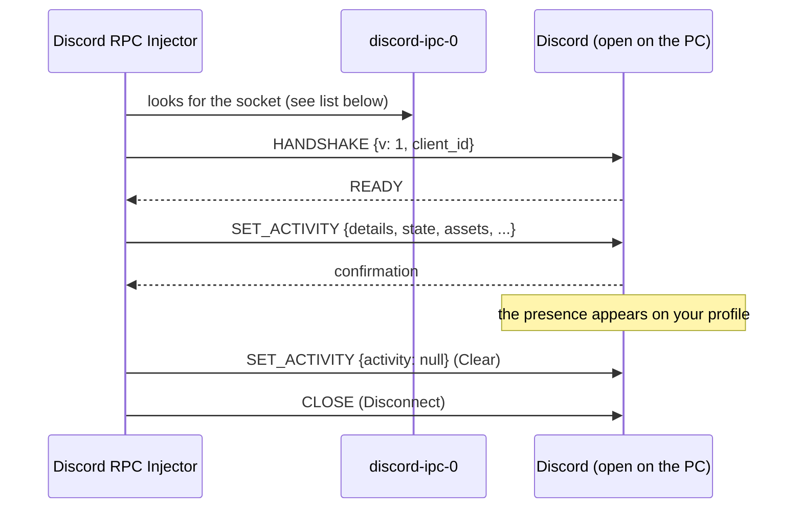

# 4. How it works

> **Summary:** Discord, running on your PC, listens on a special file called
> `discord-ipc-0`. The app finds that file, introduces itself with the Application ID and
> sends the activity as JSON. No external server, token or login is involved.

## The idea in one picture



## 1. Finding the socket

Each way of installing Discord puts the socket in a different place. The engine looks in
this order and uses the first one that responds:

| Order | Folder                                                      | Created by                        |
|-------|-------------------------------------------------------------|-----------------------------------|
| 1     | `$XDG_RUNTIME_DIR/`                                         | Native Discord (rpm, deb, tar.gz) |
| 2     | `$XDG_RUNTIME_DIR/app/com.discordapp.Discord/`              | Discord Flatpak (Flathub)         |
| 3     | `$XDG_RUNTIME_DIR/.flatpak/com.discordapp.Discord/xdg-run/` | Discord Flatpak (Flatpak 1.15+)   |
| 4     | the same two folders for `com.discordapp.DiscordCanary` and `dev.vencord.Vesktop` | Canary and Vesktop Flatpak |
| 5     | `$XDG_RUNTIME_DIR/snap.discord/`                            | Discord Snap                      |
| 6     | `$TMPDIR`, `$TMP`, `$TEMP`, `/tmp`                          | Discord without `XDG_RUNTIME_DIR` |

In each folder, `discord-ipc-0` through `discord-ipc-9` are tested (the number goes up when
more than one Discord is open, for example the stable one and Canary).

`$XDG_RUNTIME_DIR` is usually `/run/user/<your uid>`, for example `/run/user/1000`. If the
variable does not exist, the engine uses that default path.

### The Flatpak case

The Flathub Discord runs in a sandbox, so the "real" socket lives inside it. For programs
from outside to reach it, the **official Flathub launcher** runs a small relay (`socat`) that
creates the socket in `$XDG_RUNTIME_DIR/app/com.discordapp.Discord/`. The engine looks in that
folder directly. So, unlike many other programs, **it does not need any symbolic link** to be
created by hand.

If you have already created a link (for example with `systemd-tmpfiles`) for another program,
that is fine: the engine notices that the link and the socket are the same file and tries it
only once.

## 2. Introducing itself (handshake)

The engine sends the Application ID. Discord replies:

- **READY**: all good, connection open;
- **refusal with a code** (e.g. 4000, "Invalid Client ID"): the ID does not exist. The engine
  reports it right away and does not try other paths, because they all lead to the same Discord.

## 3. Sending the activity

The fields you filled in become JSON in the format Discord expects. Empty fields are left out:

```json
{
  "details": "Just Chilling",
  "state": "(KDE Plasma)",
  "timestamps": { "start": 1764100000 },
  "assets": { "large_image": "logo", "large_text": "Fedora 43" },
  "buttons": [ { "label": "Site", "url": "https://fedoraproject.org" } ],
  "party": { "id": "…", "size": [1, 4] }
}
```

## Message format (for the curious)

Each message on the socket has an 8-byte header followed by the JSON:

```
┌──────────────┬──────────────┬─────────────────────┐
│ opcode (u32) │ length (u32) │ JSON (UTF-8)        │
│ little-endian│ little-endian│                     │
└──────────────┴──────────────┴─────────────────────┘
opcodes: 0 = HANDSHAKE, 1 = FRAME (commands), 2 = CLOSE
```

## Timeouts

Discord sometimes **holds the handshake for a few seconds**, especially when connections are
opened and closed in quick succession. The engine waits up to:

| Step                          | Time   |
|-------------------------------|--------|
| Opening the connection        | 2 s    |
| Waiting for READY             | 12 s   |
| Sending/clearing the presence | 10 s   |

If a socket does not respond in time, the engine tries the next one in the list. If none
responds, the error message says which path failed and why.

## What the app does **not** do

- It does not use your token, password or account: it only talks to Discord already open.
- It does not access the internet. The presence is published by Discord itself.
- It does not need `sudo`: everything lives in folders under your user.

---

Previous: [Using the app](03-usando-o-app.md) · Next: [Compatibility](05-compatibilidade.md)
