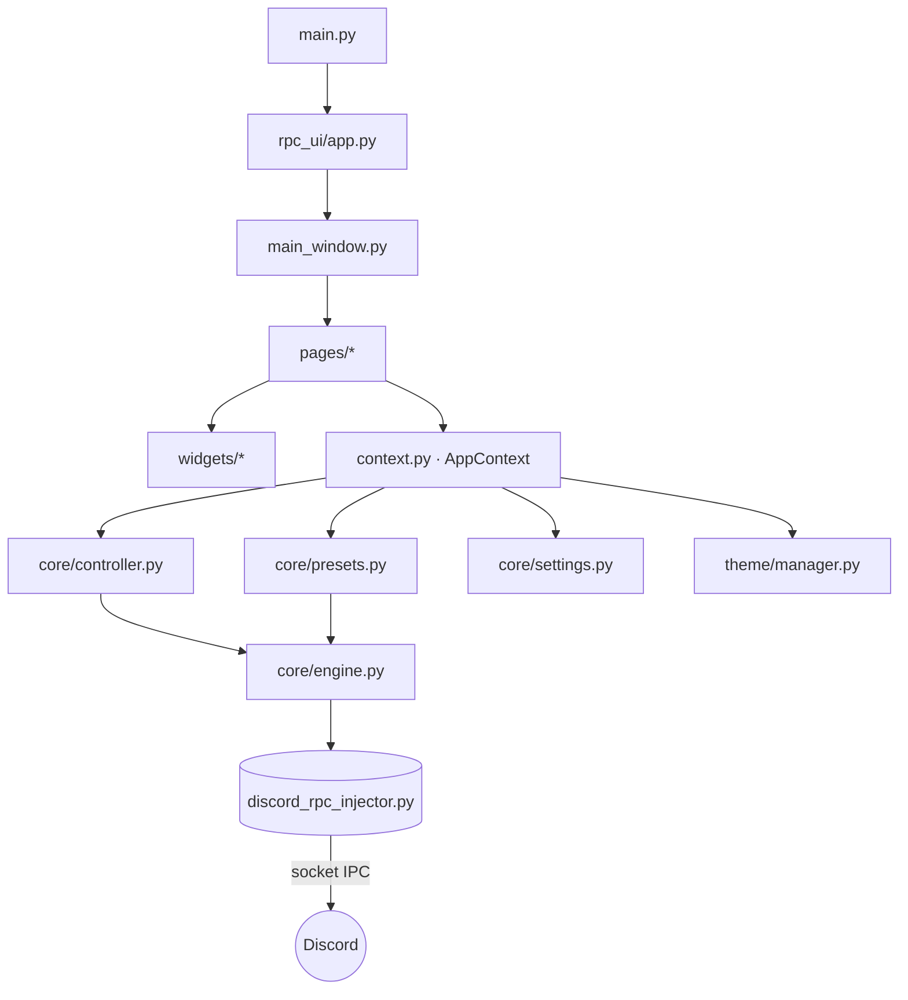
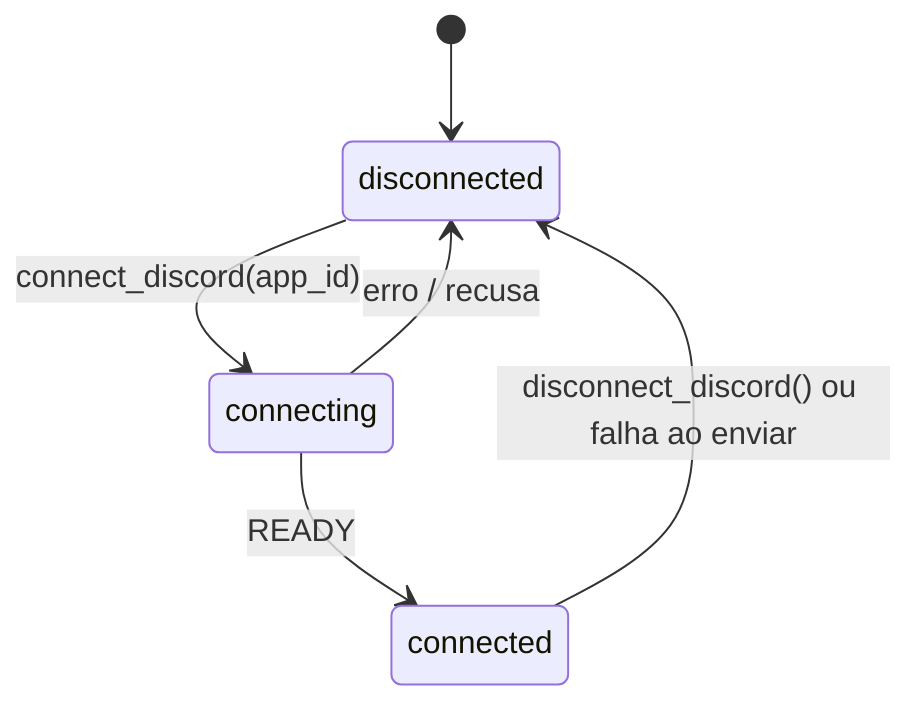
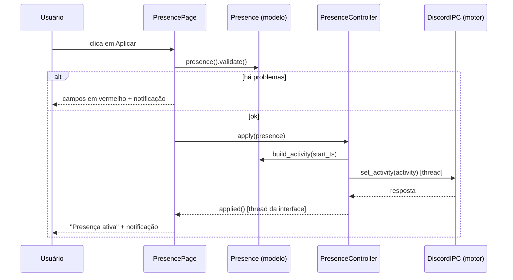

# 7. Arquitetura

> **Resumo:** um **motor** sem interface (`discord_rpc_injector.py`, só biblioteca padrão)
> e uma **interface** Qt (`rpc_ui/`) organizada em camadas: núcleo, tema, widgets e
> páginas. As páginas recebem os serviços por injeção, o que facilita os testes.

## Visão geral



**Regra de dependência:** as setas só apontam para baixo. O motor não conhece a interface,
os widgets não conhecem as páginas e as páginas não falam com o motor diretamente.

## Estrutura de pastas

```
discord_rpc_injector.py   Motor: IPC com o Discord + predefinições em JSON
main.py                   Ponto de entrada (app, --install-desktop, --uninstall-desktop)
rpc_icon.svg / .png       Ícone do app
rpc_ui/
├── app.py                Cria o QApplication, o AppContext e a janela
├── context.py            AppContext: serviços compartilhados pelas páginas
├── main_window.py        Barra lateral + barra superior + páginas; atalhos e bandeja
├── desktop_entry.py      Gera/instala o atalho .desktop e o ícone
├── core/                 Lógica sem widgets
│   ├── engine.py         Adaptador: único ponto que importa o motor
│   ├── models.py         Presence: campos, validação e payload SET_ACTIVITY
│   ├── controller.py     Conexão/aplicar/limpar em segundo plano; histórico (log)
│   ├── presets.py        PresetStore: repositório observável de predefinições
│   └── settings.py       AppSettings: preferências (QSettings)
├── theme/
│   ├── palette.py        Tokens de cor: claro, escuro e leitura do KDE (kdeglobals)
│   ├── stylesheet.py     Gera o QSS a partir dos tokens
│   └── manager.py        Aplica o tema e reage a mudanças do sistema
├── widgets/              Componentes reutilizáveis, sem lógica de negócio
│   ├── sidebar.py  header.py  card.py  fields.py  buttons.py  status.py
│   ├── empty_state.py  toast.py  dialogs.py  suggestions.py
│   ├── activity_preview.py  icons.py  style.py
└── pages/                Uma tela por arquivo
    ├── base.py           Contrato Page
    ├── presence.py  presets.py  log.py  settings.py
tests/                    Testes (unittest) com Qt offscreen e Discord simulado
docs/                     Esta documentação
```

## As camadas

### Motor (`discord_rpc_injector.py`)

Fala o protocolo IPC do Discord e lê/grava `presets.json`. Não importa nada além da
biblioteca padrão, por isso pode ser usado sozinho em scripts. Veja a
[Referência do motor](09-referencia-do-motor.md).

### Núcleo (`rpc_ui/core/`)

| Módulo          | Responsabilidade                                                         |
|-----------------|--------------------------------------------------------------------------|
| `engine.py`     | Reexporta `DiscordIPC`, `load_presets`, `save_presets` e caminhos úteis   |
| `models.py`     | `Presence` (dataclass): `to_dict`/`from_dict`, `validate()`, `build_activity()` |
| `controller.py` | `PresenceController`: estados `disconnected → connecting → connected`    |
| `presets.py`    | `PresetStore`: `names/get/put/rename/delete` + sinal `changed`           |
| `settings.py`   | `AppSettings`: `theme`, `close_to_tray`, `last_app_id` + sinal `changed` |

O controlador executa as chamadas de rede numa thread e devolve o resultado à thread da
interface por um sinal Qt. Assim a janela nunca congela.



Sinais do `PresenceController`: `state_changed(str)`, `applied()`, `cleared()`,
`failed(título, mensagem)` e `logged(LogEntry)`.

### Tema (`rpc_ui/theme/`)

1. `palette.py` produz um `Tokens` (cores nomeadas: `window`, `surface`, `text`, `accent`…).
2. `stylesheet.py` transforma os tokens em QSS.
3. `manager.py` aplica paleta + QSS e, no modo **Sistema**, observa o `kdeglobals` e a dica
   de esquema de cores do Qt para reaplicar quando o tema do sistema muda.

Os widgets **não têm cores fixas**: usam `objectName` ou a propriedade dinâmica `variant`,
e o QSS decide a aparência.

### Widgets (`rpc_ui/widgets/`)

Componentes genéricos que poderiam ser usados em outro app:

| Widget             | Uso                                                       |
|--------------------|-----------------------------------------------------------|
| `Sidebar`          | Navegação lateral com seções, badges e rodapé             |
| `PageHeader`       | Título, subtítulo, busca e ações da página                |
| `Card`             | Superfície com título, subtítulo e ações                  |
| `FormGrid`         | Formulário rótulo/campo em 1 a 3 colunas                  |
| `TextField`        | Campo com botão de limpar e estado inválido               |
| `Button`           | Variantes `default`, `primary`, `danger`, `flat`          |
| `StatusPill`       | Selo de estado da conexão                                 |
| `EmptyState`       | Mensagem central com ícone e ação opcional                |
| `ToastHost`        | Notificações empilhadas, com ação (ex.: Desfazer)         |
| `ConfirmDialog`, `TextInputDialog`, `DialogService` | Diálogos e um serviço substituível nos testes |
| `SuggestionList`   | Lista de sugestões ancorada a um campo (QCompleter)       |
| `ActivityPreview`  | Pré-visualização do cartão de atividade                   |

### Páginas (`rpc_ui/pages/`)

Cada página herda de `Page` e informa à janela:

- `title`, `icon`, `subtitle()`: o que a barra superior mostra;
- `header_actions()`: os botões de ação dessa página;
- `search_placeholder` + `set_filter(text)`: se a página tem busca;
- o sinal `header_changed`, para pedir atualização do subtítulo.

A `MainWindow` liga as páginas entre si. Por exemplo, "Carregar" em Predefinições chama
`PresencePage.load_preset()` e navega para a página Presença.

## Fluxo: do clique em "Aplicar" ao Discord



## Decisões de projeto

- **Motor separado e sem dependências:** pode ser testado e reutilizado sem Qt.
- **Injeção de serviços (`AppContext`):** os testes trocam o IPC, os diálogos e o
  armazenamento por versões falsas, sem mexer no código das páginas.
- **Tema por tokens:** trocar ou adicionar um tema é mudar dados, não widgets.
- **Dados no padrão XDG:** nada é gravado na pasta do projeto, que pode ficar somente leitura.

---

Anterior: [Solução de problemas](06-solucao-de-problemas.md) · Próximo: [Desenvolvimento](08-desenvolvimento.md)
