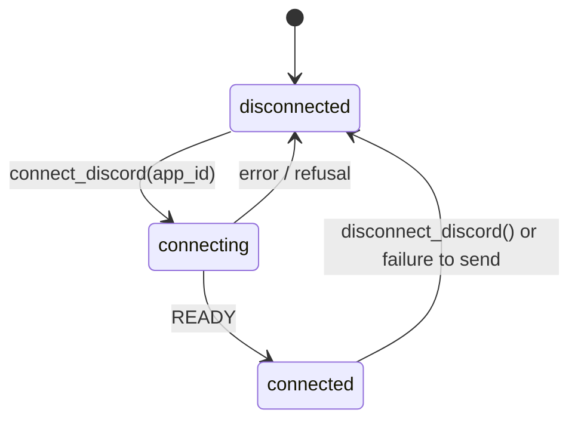
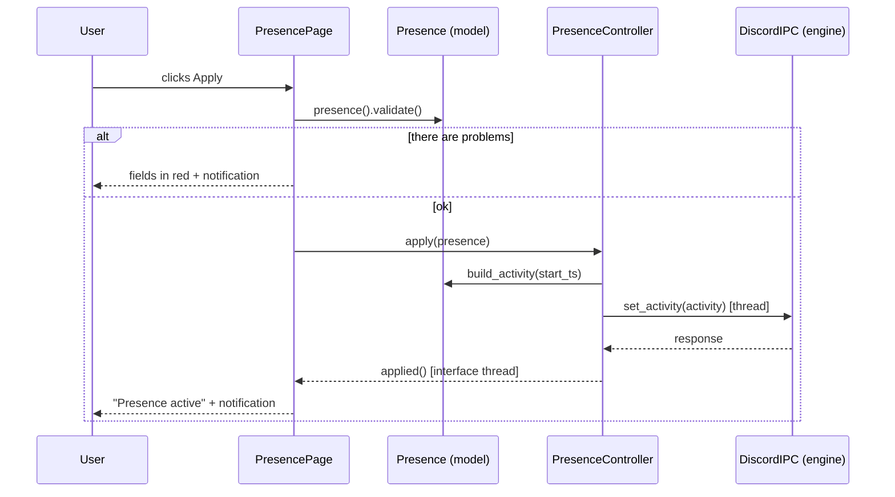

# 7. Architecture

> **Summary:** an interface-free **engine** (`discord_rpc_injector.py`, standard library only)
> and a Qt **interface** (`rpc_ui/`) organised in layers: core, theme, widgets and pages.
> Pages receive their services by injection, which makes testing easier.

## Overview


**Dependency rule:** arrows only point down. The engine does not know the interface, the
widgets do not know the pages, and the pages do not talk to the engine directly.

## Folder structure

```
discord_rpc_injector.py   Engine: IPC with Discord + presets in JSON
main.py                   Entry point (app, --install-desktop, --uninstall-desktop)
rpc_icon.svg / .png       App icon
rpc_ui/
├── app.py                Creates the QApplication, the AppContext and the window
├── context.py            AppContext: services shared by the pages
├── main_window.py        Sidebar + top bar + pages; shortcuts and tray
├── desktop_entry.py      Generates/installs the .desktop file and the icon
├── core/                 Logic without widgets
│   ├── engine.py         Adapter: the only point that imports the engine
│   ├── models.py         Presence: fields, validation and the SET_ACTIVITY payload
│   ├── controller.py     Connect/apply/clear in the background; history (log)
│   ├── presets.py        PresetStore: observable preset repository
│   └── settings.py       AppSettings: preferences (QSettings)
├── theme/
│   ├── palette.py        Colour tokens: light, dark and KDE reading (kdeglobals)
│   ├── stylesheet.py     Generates the QSS from the tokens
│   └── manager.py        Applies the theme and reacts to system changes
├── widgets/              Reusable components, no business logic
│   ├── sidebar.py  header.py  card.py  fields.py  buttons.py  status.py
│   ├── empty_state.py  toast.py  dialogs.py  suggestions.py
│   ├── activity_preview.py  icons.py  style.py
└── pages/                One screen per file
    ├── base.py           Page contract
    ├── presence.py  presets.py  log.py  settings.py
tests/                    Tests (unittest) with Qt offscreen and a simulated Discord
docs/                     This documentation
```

## The layers

### Engine (`discord_rpc_injector.py`)

Speaks Discord's IPC protocol and reads/writes `presets.json`. It imports nothing beyond the
standard library, so it can be used on its own in scripts. See the
[Engine reference](09-referencia-do-motor.md).

### Core (`rpc_ui/core/`)

| Module          | Responsibility                                                              |
|-----------------|-----------------------------------------------------------------------------|
| `engine.py`     | Re-exports `DiscordIPC`, `load_presets`, `save_presets` and useful paths    |
| `models.py`     | `Presence` (dataclass): `to_dict`/`from_dict`, `validate()`, `build_activity()` |
| `controller.py` | `PresenceController`: states `disconnected → connecting → connected`        |
| `presets.py`    | `PresetStore`: `names/get/put/rename/delete` + `changed` signal             |
| `settings.py`   | `AppSettings`: `theme`, `close_to_tray`, `last_app_id` + `changed` signal   |

The controller runs the network calls in a thread and hands the result back to the interface
thread through a Qt signal. This way the window never freezes.



Signals of `PresenceController`: `state_changed(str)`, `applied()`, `cleared()`,
`failed(title, message)` and `logged(LogEntry)`.

### Theme (`rpc_ui/theme/`)

1. `palette.py` produces a `Tokens` object (named colours: `window`, `surface`, `text`, `accent`…).
2. `stylesheet.py` turns the tokens into QSS.
3. `manager.py` applies the palette + QSS and, in **System** mode, watches `kdeglobals` and
   Qt's colour-scheme hint so it reapplies when the system theme changes.

Widgets have **no fixed colours**: they use an `objectName` or the dynamic `variant` property,
and the QSS decides the look.

### Widgets (`rpc_ui/widgets/`)

Generic components that could be used in another app:

| Widget             | Use                                                        |
|--------------------|------------------------------------------------------------|
| `Sidebar`          | Side navigation with sections, badges and footer           |
| `PageHeader`       | Title, subtitle, search and page actions                   |
| `Card`             | Surface with title, subtitle and actions                   |
| `FormGrid`         | Label/field form in 1 to 3 columns                         |
| `TextField`        | Field with a clear button and invalid state                |
| `Button`           | `default`, `primary`, `danger`, `flat` variants            |
| `StatusPill`       | Connection state badge                                     |
| `EmptyState`       | Centred message with icon and optional action              |
| `ToastHost`        | Stacked notifications, with an action (e.g. Undo)          |
| `ConfirmDialog`, `TextInputDialog`, `DialogService` | Dialogs and a service that can be replaced in tests |
| `SuggestionList`   | Suggestion list anchored to a field (QCompleter)           |
| `ActivityPreview`  | Preview of the activity card                               |

### Pages (`rpc_ui/pages/`)

Each page inherits from `Page` and tells the window:

- `title`, `icon`, `subtitle()`: what the top bar shows;
- `header_actions()`: the action buttons for that page;
- `search_placeholder` + `set_filter(text)`: whether the page has search;
- the `header_changed` signal, to request a subtitle update.

`MainWindow` connects the pages to each other. For example, "Load" on Presets calls
`PresencePage.load_preset()` and navigates to the Presence page.

## Flow: from clicking "Apply" to Discord



## Design decisions

- **Separate engine with no dependencies:** it can be tested and reused without Qt.
- **Service injection (`AppContext`):** tests swap the IPC, the dialogs and the storage for
  fake versions, without touching the page code.
- **Theme by tokens:** changing or adding a theme means changing data, not widgets.
- **Data in the XDG standard:** nothing is written to the project folder, which may be
  read-only.

---

Previous: [Troubleshooting](06-solucao-de-problemas.md) · Next: [Development](08-desenvolvimento.md)
